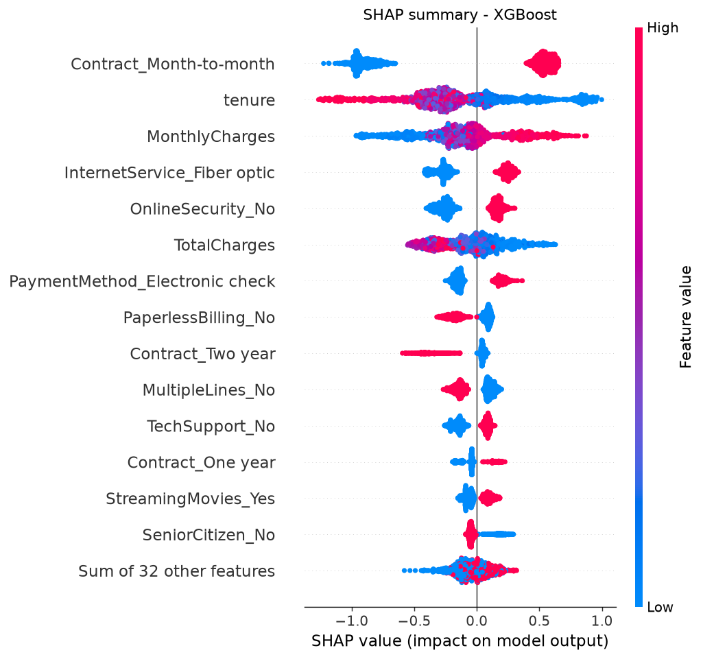
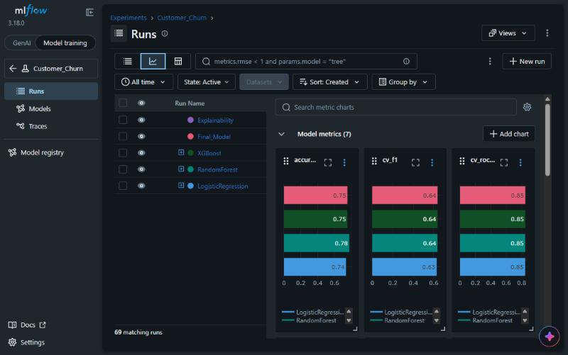
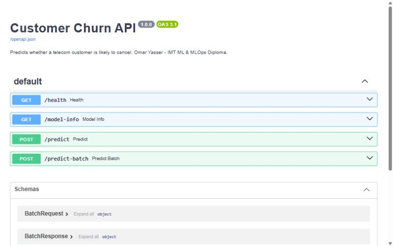
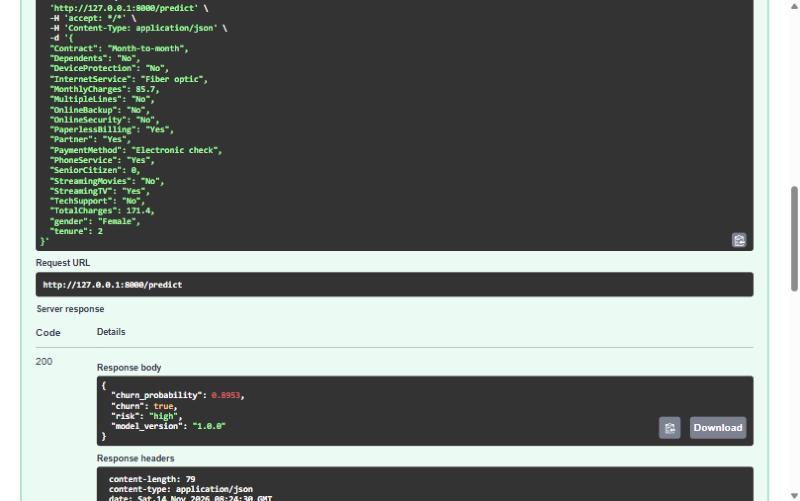
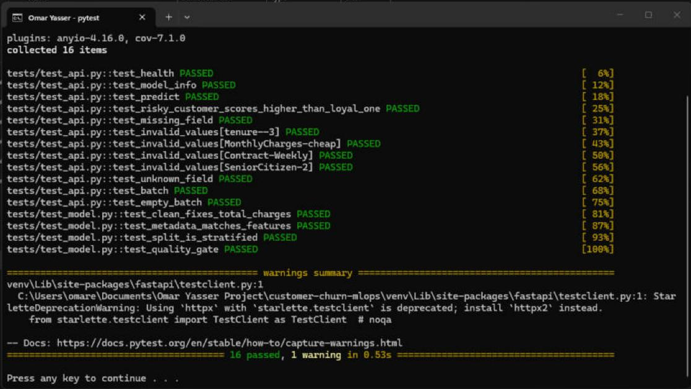

# Customer Churn Prediction with End-to-End MLOps

**Omar Yasser** · IMT Machine Learning & MLOps Diploma · Graduation project (Option 1, supervised)

A telecom company loses about one in four customers. This project trains a model that flags the
customers most likely to leave, explains *why* each one is at risk, and serves the predictions
through a FastAPI service packaged in Docker. Every experiment is tracked in MLflow and every push
runs the tests and builds the image on GitHub Actions.

Dataset: [Telco Customer Churn](https://www.kaggle.com/datasets/blastchar/telco-customer-churn) (IBM sample, 7,043 customers, 21 columns).

## Results at a glance

| Model (best of grid search) | CV F1 | Accuracy | Precision | Recall | F1 | ROC-AUC |
|---|---|---|---|---|---|---|
| Logistic Regression (C=10, balanced) | 0.630 | 0.738 | 0.504 | 0.782 | 0.613 | 0.840 |
| Random Forest (200 trees, leaf 5, balanced) | 0.637 | **0.776** | **0.561** | 0.704 | 0.625 | 0.838 |
| **XGBoost** (depth 3, lr 0.05, 200 trees, pos weight 2.8) | **0.638** | 0.754 | 0.524 | **0.785** | **0.629** | **0.844** |

Test set = 1,405 customers (20 %, stratified). Threshold 0.5.
XGBoost was picked because it had the best cross-validated F1, and it also came out on top on the
test set. It catches **292 of the 372 customers who actually left (78.5 %)**.

## Project structure

```
customer-churn-mlops/
├── .github/workflows/ci.yml   tests + docker build + smoke test on every push
├── app/                       FastAPI service (main.py, schemas.py)
├── data/download_data.py      gets the CSV
├── models/                    churn_model.joblib, model_metadata.json
├── reports/                   figures/, eda_summary.json, explain/
├── screenshots/               proof screenshots used in the report
├── src/
│   ├── config.py              paths, columns, seed
│   ├── data.py                loading, cleaning, stratified split
│   ├── eda.py                 EDA plots and churn-rate tables
│   ├── features.py            ColumnTransformer (scaling + one-hot)
│   ├── models.py              the three models and their grids
│   ├── train.py               GridSearchCV + MLflow tracking
│   └── explain.py             feature importance, SHAP, LIME
├── tests/                     API tests + quality gate
├── Dockerfile, .dockerignore
└── requirements.txt, requirements-dev.txt, sample_request.json
```

## How to run it

Python 3.14, Git, and Docker for the container part.

```bash
git clone https://github.com/omrsiuomar-beep/customer-churn-mlops.git
cd customer-churn-mlops
python -m venv venv
venv\Scripts\activate          # Windows  (source venv/bin/activate on Mac/Linux)
pip install -r requirements-dev.txt

python data/download_data.py
python src/eda.py              # charts -> reports/figures
python src/train.py            # grid search, logs everything to MLflow
python src/explain.py          # SHAP + LIME
pytest -v                      # 16 tests incl. the quality gate

mlflow ui --backend-store-uri sqlite:///mlflow.db --port 5050
uvicorn app.main:app --reload  # http://127.0.0.1:8000/docs
```

Docker:

```bash
docker build -t churn-api:1.0 .
docker run -d -p 8000:8000 --name churn-api churn-api:1.0
curl -X POST http://localhost:8000/predict -H "Content-Type: application/json" -d @sample_request.json
```

## A. Data preparation and EDA

- No real NaNs, but **11 `TotalCharges` values are blank strings**, so pandas reads the whole column
  as text. All 11 are customers with `tenure = 0`, they simply haven't been billed yet, so they get
  `0` instead of the median.
- `customerID` is dropped. After that **22 rows are exact duplicates**, which I removed so the same
  customer can't end up in both train and test.
- Churn rate is **26.5 %**, so the classes are imbalanced. The split is stratified and the models
  are tuned on F1, not accuracy.

What the EDA shows:

| Group | Churn rate |
|---|---|
| Month-to-month contract | 42.7 % |
| One-year contract | 11.3 % |
| Two-year contract | 2.8 % |
| Fiber optic internet | 41.9 % |
| Pays by electronic check | 45.3 % |
| First 6 months with the company | 52.9 % |
| More than 5 years with the company | 6.6 % |

Churners have a median tenure of 10 months against 38 for customers who stay, and pay more per
month (79.65 vs 64.43). Contract type has the strongest correlation with churn (+0.41 for
month-to-month), followed by tenure (−0.35).


## B. Feature engineering

- `LabelEncoder` turns the target (`No`/`Yes`) into 0/1.
- `OneHotEncoder` for the 16 categorical columns (`handle_unknown="ignore"` so the API doesn't
  crash on an unseen value), `StandardScaler` for tenure, monthly and total charges.
- Everything lives in one `ColumnTransformer` inside the model pipeline, so the exact same steps run
  in training, in the tests and in the API. 19 input columns become 46 model features.

## C. Training and evaluation

`GridSearchCV` with 5-fold stratified CV for each algorithm (8 + 24 + 32 = 64 combinations, 320 fits).
Each grid is refit on F1 because a model that rarely predicts churn can still score well on
accuracy. The grids include the class-balancing options (`class_weight`, `scale_pos_weight`) and
the balanced version won in all three, which is why recall sits close to 0.8.

All three models end up close (ROC-AUC 0.838 – 0.844). The data is fairly simple, and a tuned
linear model is nearly as good as boosting. XGBoost wins by a small margin on recall and F1.


## D. Interpretability

- **XGBoost importance:** `Contract_Month-to-month` alone accounts for 47 % of the gain.
- **SHAP** (on the served model): the top drivers are month-to-month contract, tenure, monthly
  charges, fiber optic, no online security, total charges and electronic check. Short tenure and
  high monthly charges push towards churn, while a two-year contract pushes strongly away from it.
- **LIME** on the highest-risk test customer (97 % predicted, and she did leave): month-to-month,
  1 month of tenure, $100.80 a month on fiber optic, no online security. LIME and SHAP agree.



## E. Deployment

| Endpoint | What it does |
|---|---|
| `GET /health` | `{"status": "ok"}` once the model is loaded |
| `GET /model-info` | model name, version, best params, metrics |
| `POST /predict` | one customer → `churn_probability`, `churn`, `risk` (low/medium/high) |
| `POST /predict-batch` | up to 1,000 customers |

Inputs are checked by Pydantic: wrong types, unknown categories (e.g. `"Contract": "Weekly"`),
negative tenure, missing or extra fields all return **422**. The model is loaded once at startup.

The Docker image uses `python:3.14-slim`, installs only the runtime requirements (no MLflow, SHAP or
Jupyter), copies just the API code and the model, runs as a non-root user and has a health check.

## F. MLOps

- **MLflow** experiment `Customer_Churn`: one parent run per algorithm with its best params, CV and
  test metrics, confusion matrix, grid results CSV and the fitted model, plus a child run for every
  grid combination (64). A `Final_Model` run holds the chosen pipeline and an `Explainability` run
  holds the SHAP and LIME plots.
- **Tests** (`pytest`): 16 tests covering the API (valid input, risky vs loyal customer, invalid
  values, batch) and a **quality gate** that fails the build if test ROC-AUC drops below 0.82 or
  recall below 0.50.
- **GitHub Actions**: every push and PR installs, downloads the data, runs the tests, builds the
  Docker image and calls `/health` and `/predict` on the running container.

## Limitations and next steps

- Precision is about 0.52, so roughly half of the flagged customers would have stayed anyway. That's
  fine for a cheap retention offer (a discount or a call), less so for an expensive one. The
  threshold can be raised if the business cares more about precision.
- It is a single snapshot of one company. In production I would retrain monthly and watch for
  drift on contract mix and monthly charges.
- LIME shows the scaled values (e.g. tenure ≤ −0.96 means a very new customer), which is less
  readable than the raw numbers.

## Screenshots

| | |
|---|---|
| MLflow runs (parent + grid-search child runs) |  |
| MLflow model comparison |  |
| XGBoost run metrics and params |  |
| SHAP plot stored in MLflow |  |
| FastAPI docs |  |
| `/predict` response |  |
| pytest, 16 passed |  |
