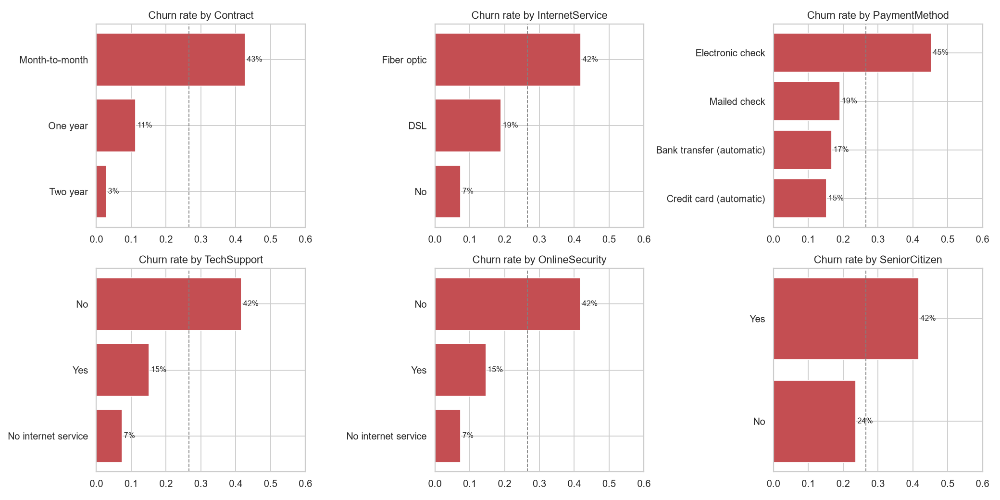
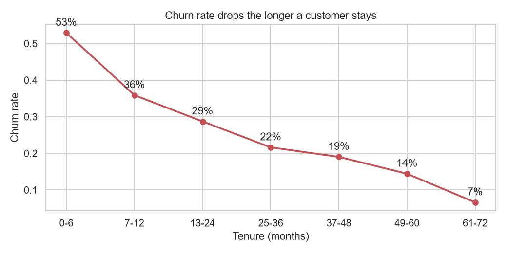
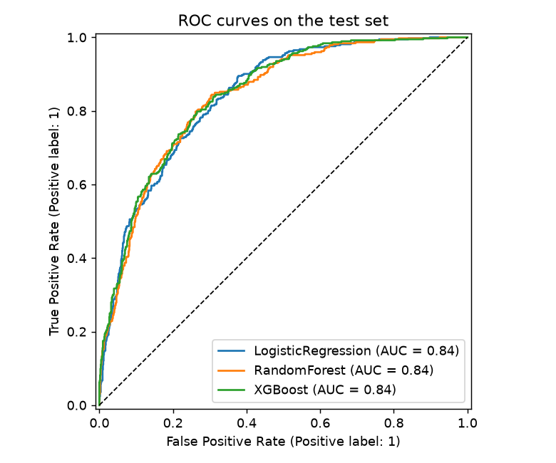
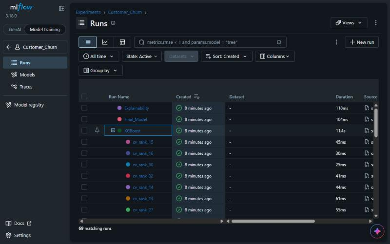
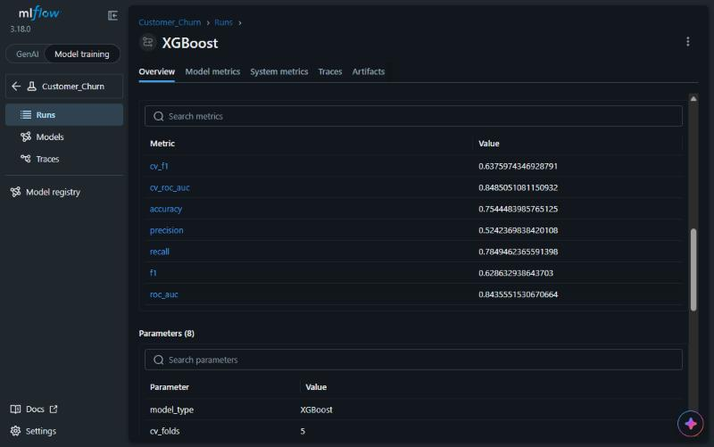
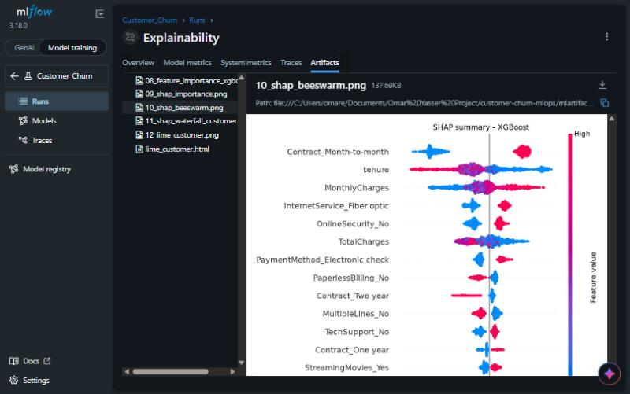
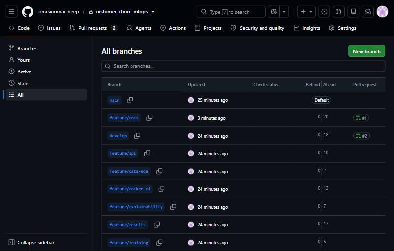

# Customer Churn Prediction + MLOps

Graduation project for the **IMT Machine Learning & MLOps Diploma** (Option 1 - supervised learning).
Made by **Omar Yasser**.

The idea: a telecom company loses about 1 of every 4 customers. I trained a model that predicts
which customers will leave, explained why using SHAP and LIME, and put the model behind a FastAPI
service with Docker. Experiments are tracked in MLflow and GitHub Actions runs the tests on every push.

I wrote everything in VS Code (Python + Jupyter extensions) on Windows with Python 3.14.

Dataset: [Telco Customer Churn](https://www.kaggle.com/datasets/blastchar/telco-customer-churn) - 7,043 customers, 21 columns.

## Results

| Model | CV F1 | Accuracy | Precision | Recall | F1 | ROC-AUC |
|---|---|---|---|---|---|---|
| Logistic Regression | 0.630 | 0.738 | 0.504 | 0.782 | 0.613 | 0.840 |
| Random Forest | 0.637 | **0.776** | **0.561** | 0.704 | 0.625 | 0.838 |
| **XGBoost** | **0.638** | 0.754 | 0.524 | **0.785** | **0.629** | **0.844** |

Test set is 1,405 customers (20%, stratified), threshold 0.5.

I picked XGBoost because it had the best CV F1 and it was also the best on the test set.
It finds 292 out of the 372 customers that really left (78.5%).

Best params: `max_depth=3, learning_rate=0.05, n_estimators=200, subsample=0.8, scale_pos_weight=2.8`

## Folders

```
customer-churn-mlops/
├── .github/workflows/ci.yml   tests + docker build on every push
├── .vscode/                   my VS Code settings and run configs
├── app/                       FastAPI (main.py, schemas.py)
├── data/download_data.py      downloads the csv
├── models/                    churn_model.joblib + model_metadata.json
├── reports/                   figures and json summaries
├── screenshots/
├── src/
│   ├── config.py              paths and column names
│   ├── data.py                load, clean, split
│   ├── eda.py                 EDA plots
│   ├── features.py            preprocessing (one-hot + scaling)
│   ├── models.py              the 3 models and their grids
│   ├── train.py               grid search + MLflow
│   └── explain.py             feature importance, SHAP, LIME
├── tests/                     api tests + quality gate
└── Dockerfile
```

## How to run

```bash
git clone https://github.com/omrsiuomar-beep/customer-churn-mlops.git
cd customer-churn-mlops
python -m venv venv
venv\Scripts\activate
pip install -r requirements-dev.txt

python data/download_data.py
python src/eda.py
python src/train.py
python src/explain.py
pytest -v

mlflow ui --backend-store-uri sqlite:///mlflow.db --port 5050
uvicorn app.main:app --reload
```

In VS Code you can also use the run configs in `.vscode/launch.json` (Train models, EDA, Run API).
The API docs open on http://127.0.0.1:8000/docs

Docker:

```bash
docker build -t churn-api .
docker run -d -p 8000:8000 churn-api
curl -X POST http://localhost:8000/predict -H "Content-Type: application/json" -d @sample_request.json
```

## What I found in the data

- `TotalCharges` looked complete but 11 values were empty strings. All of them have tenure 0
  (new customers, no bill yet) so I set them to 0.
- After dropping `customerID` there were 22 duplicate rows, I removed them.
- 26.5% of customers left, so the data is imbalanced.

| | Churn rate |
|---|---|
| Month-to-month contract | 42.7% |
| One year contract | 11.3% |
| Two year contract | 2.8% |
| Fiber optic | 41.9% |
| Electronic check | 45.3% |
| First 6 months | 52.9% |
| More than 5 years | 6.6% |

Contract type is the biggest signal. New customers leave a lot, after 5 years almost nobody leaves.




## Preprocessing

- LabelEncoder for the target (No/Yes -> 0/1)
- OneHotEncoder for the 16 categorical columns (`handle_unknown="ignore"`)
- StandardScaler for tenure, MonthlyCharges, TotalCharges
- all inside one `ColumnTransformer` + `Pipeline`, so training and the API use exactly the same steps

## Training

GridSearchCV with 5-fold stratified CV for each model (64 combinations total). I used F1 to choose
the best params and not accuracy, because a model that says "nobody leaves" already gets ~74% accuracy.
The balanced options (`class_weight="balanced"`, `scale_pos_weight=2.8`) won for all 3 models.



## Explainability

- XGBoost importance: `Contract_Month-to-month` alone is 47% of the gain
- SHAP: month-to-month, short tenure, high monthly charges, fiber optic, no online security and
  electronic check push towards leaving. Two year contract pushes towards staying.
- LIME on the riskiest test customer (97%, and she did leave): month-to-month, 1 month tenure,
  fiber optic at $100.80/month, no online security


## API

| Endpoint | |
|---|---|
| `GET /health` | status |
| `GET /model-info` | model name, params, metrics |
| `POST /predict` | one customer -> churn probability + risk (low/medium/high) |
| `POST /predict-batch` | up to 1000 customers |

Pydantic checks the input. Wrong types, unknown categories, negative tenure or missing fields
return 422.

## MLOps

- **MLflow**: one run per model with its best params, metrics, confusion matrix and the model,
  plus a child run for every grid combination
- **Tests**: 16 pytest tests. The quality gate fails if ROC-AUC < 0.82 or recall < 0.50
- **GitHub Actions**: install, download data, run tests, build the Docker image and call
  `/health` and `/predict` on the container
- **Git**: every part on its own feature branch, merged into `develop`, then into `main`

## Screenshots

| | |
|---|---|
| MLflow runs |  |
| MLflow compare |  |
| XGBoost run |  |
| SHAP in MLflow |  |
| API docs |  |
| /predict |  |
| pytest |  |
| GitHub branches |  |

## What I would do next

- precision is around 0.52, so half of the flagged customers would stay anyway. Fine for a phone
  call or small discount, but for expensive offers I would raise the threshold
- retrain every month and check for drift
- deploy the container on a cloud service
